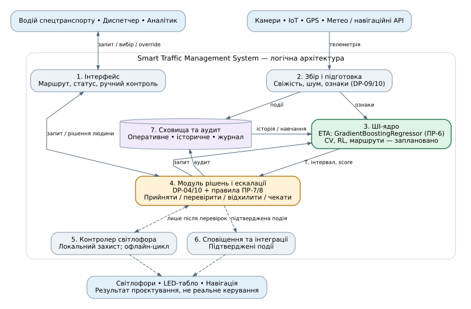

# Smart Traffic Management System

**Інтелектуальна система управління міським трафіком** · Махун Владислав, група 242 · ПР-1–ПР-8

Навчальний інженерний проєкт. Реалізовано прототип прогнозування ETA спецтранспорту та симуляційний модуль прийняття рішень. Інші функції представлені на рівні архітектури. Жодних команд реальним світлофорам немає.

## Problem
Затори, неефективні фази світлофорів і затримки екстрених служб. Мета ПР-1 — зменшити час поїздок, аварійність та простої. Очікувані 15–20% економії часу є ціллю, не виміряним ефектом.

## Users
Водії швидкої, поліції, ДСНС, диспетчери трафіку і громадського транспорту, аналітики міської адміністрації; водії та пішоходи отримують користь і сповіщення.

## Solution
Дані з камер, IoT, GPS і зовнішніх API очищуються та перетворюються на ознаки. ШІ пропонує прогнози і рекомендації, модуль рішень застосовує правила, людина підтверджує або скасовує критичні рішення. Контролери мають незалежний захист та штатний офлайн-режим. Всі рішення мають записуватися в аудит.

## Architecture


Компоненти ПР-4: №1 інтерфейс; №2 збір та підготовка; №3 ШІ-ядро; №4 рішення та ескалація; №5 контролер; №6 сповіщення та інтеграції; №7 оперативне/історичне сховище та аудит. Суцільні стрілки — логічний обмін даними, пунктирні — заплановане виконання. Реалізовані частини №3 (ETA) і №4 (демонстраційні правила); інші модулі не розгорнуто.

## AI component
UC-02 / DP-04: прогноз часу прибуття до перехрестя. Три GradientBoostingRegressor (точковий прогноз, квантилі 0.1 і 0.9). 8 ознак: відстань, швидкість швидкої, черга, щільність, швидкість потоку, погода (0 ясно, 1 дощ, 2 сильний дощ), година, день тижня. GPS age перевіряється окремо. Вихід: `predicted_s`, `interval_s`, `confidence_score`, рекомендація. Score = clip(1 − ширина інтервалу / 100, 0, 1); це не ймовірність правильного прогнозу.

## Prototype
Оригінальний [Notebook ПР-6](prototype/PR6_Smart_Traffic_Prototype.ipynb) сам генерує 1200 синтетичних записів із seed 42 (960 навчальних / 240 тестових). `prototype/eta.py` містить ті самі комірки навчання й прогнозу без зміни моделі. `prototype/decision.py` додає консервативні правила ПР-7. Ознаки та GPS перевіряються до виклику моделі; будь-які реальні команди заборонені. Прапори стану сенсорів, маршруту, перешкод та override у демо задаються вручну, не надходять з реальної інфраструктури.

### Запуск (Python 3.11 або 3.12, PowerShell)
```powershell
python -m venv .venv
.\.venv\Scripts\python.exe -m pip install -r requirements.txt
.\.venv\Scripts\python.exe prototype/demo.py
.\.venv\Scripts\python.exe prototype/test_policy.py
```
Або відкрийте Notebook ПР-6 у Jupyter чи Google Colab, виконайте всі комірки. Notebook не містить нової логіки ПР-8; вона доступна в `decision.py`.

## Results
| Показник | Результат |
|---|---:|
| MAE на 240 синтетичних записах (повторний запуск ПР-8) | 3.08 с |
| MAE базового d/v | 12.17 с |
| Покриття квантильного інтервалу | 65.8% |
| ПР-7: коректні сценарії | 10/14 (71.4%) |
| ПР-7: MAE на 11 стрес-сценаріях | 23.52 с |
| ПР-8: тести правил та smoke-test | 16/16 |

[Звіт ПР-7](materials/PR7.pdf) містить 14 сценаріїв та аналіз 4 помилок. [Лог ПР-8](results/PR8_policy_tests.txt) підтверджує окремі тести правил (15 тестів із підставленим прогнозом/збоєм і один запуск реальної моделі). [Демо](results/PR8_demo.json.txt): T=12.48 с, score=0.902, інтервал 10.70–20.50 с → REVIEW; GPS 6 с → REJECT. Це не нова оцінка точності ML.

## Rules / Human-in-the-loop
Пріоритет: REJECT → REVIEW → SIMULATED_GREEN або WAIT. Відхилити відсутній/застарілий GPS (>5 с), невалідні або позадіапазонні ознаки, збій моделі, score <0.50. Передати диспетчеру при score 0.50–0.90 включно, неузгодженому інтервалі, перетині порога 15 с, небезпеці, непідтвердженому маршруті або override. Якщо весь надійний інтервал ≥15 с — чекати. Якщо T<15 с, Tmax<15 с, score>0.90, інші умови пройдені — лише симуляційна рекомендація. Реальне керування вимкнене завжди. Межі ознак відповідають діапазонам генератора, а не перевіреним фізичним межам міста.

## Limitations
Синтетичні дані; випадковий, а не часовий поділ; score некалібрований; покриття нижче номінальних 80%; погана екстраполяція; відсутні реальні сенсори, API, контролери, маршрутизація, CV/RL та сертифікація. Вимоги 500 мс, 99.99% доступності та 5 с для місячного звіту не перевірялися. Межі 0.50 і 0.90 — демонстраційні, не валідовані для безпеки.

## Future development
Зібрати реальні анонімізовані історичні поїздки, розділити за часом, відкалібрувати інтервали й оцінити небезпечні завищення ETA, провести симуляції конфліктів фаз та незалежну валідацію. Потім інтегрувати API, маршрутизацію, CV/RL, сховища, диспетчерський інтерфейс і перевірити NFR. Реальні випробування лише після незалежного підтвердження безпеки.

## Project files
- `architecture/` — фінальна схема (SVG, PNG та DOT).
- `prototype/` — оригінальний Notebook, код моделі, правила та тести.
- `data/` — синтетичний CSV ПР-6.
- `results/` — результати ПР-6, журнал тестів і демо ПР-8.
- `materials/` — вихідні ПР-1–ПР-7 (історичні, не редаговані).
- `docs/` — фінальний PDF і узгодження попередніх рішень.

Автор: Махун Владислав, група 242.

`results/PR7_scenarios.csv` — перенесена таблиця із PDF-звіту ПР-7 (округлені історичні результати, не новий запуск).
