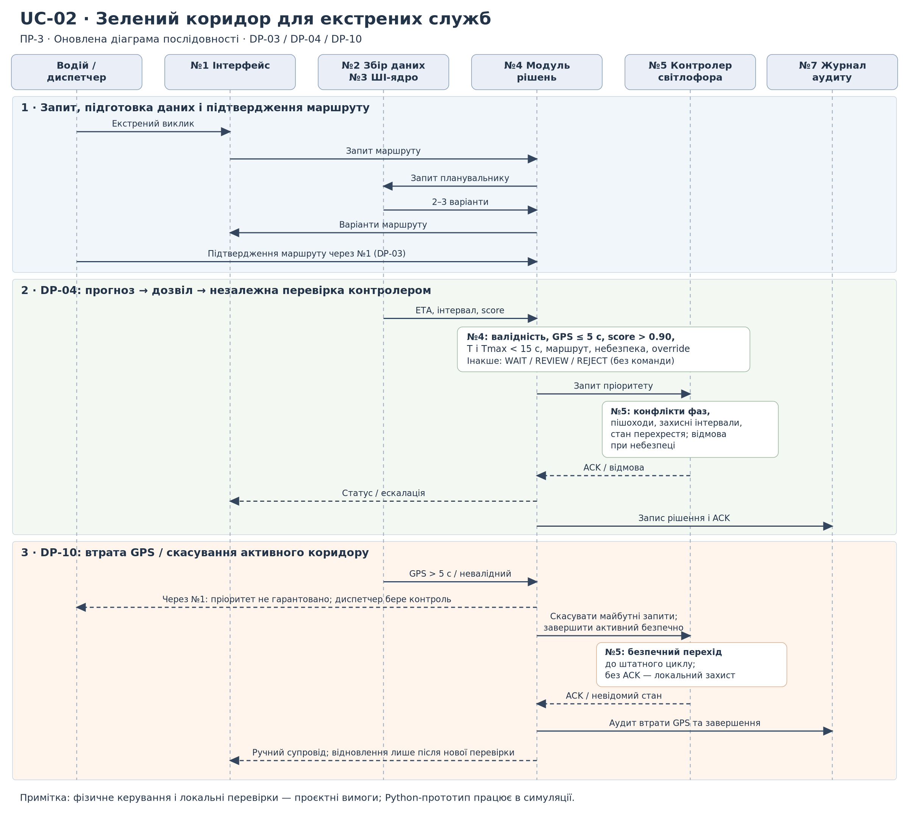

# Практична робота №3. Use Cases & Decision Points

**Проєкт:** Smart Traffic Management System  
**Виконав:** Махун Владислав, група 242  
**Редакція:** виправлено за зауваженнями викладача; узгоджено з ПР-4–ПР-8.

> Пороги є проєктними правилами. Прототип ПР-6–ПР-8 реалізує прогноз ETA та симуляційне рішення DP-04/DP-10, а не реальне керування світлофорами або CV-виявлення ДТП.

## 0. System context
- **System name:** Інтелектуальна система управління міським трафіком (Smart Traffic Management System)[cite: 1].
- **Target users:** Водії, міська адміністрація, диспетчери громадського транспорту, служби екстреного реагування (швидка медична допомога, поліція, ДСНС)[cite: 1].
- **Main value:** Мінімізація заторів, підвищення безпеки дорожнього руху та швидке створення «зелених коридорів» для екстрених служб[cite: 1].
- **AI component role:** Комп'ютерний зір (CV) розпізнає транспорт та ДТП на відеопотоках, а моделі машинного навчання (ML) прогнозують затори і динамічно оптимізують фази світлофорів[cite: 1, 2].

---

## A. Use Cases

### UC-01: Оптимізувати фази світлофорів на перехресті під час години пік
- **Primary actor:** Модуль AI (Система управління)
- **Secondary actors:** Контролери світлофорів (виконавчі пристрої)[cite: 1]
- **Trigger:** Перевищення порогу щільності трафіку на основній магістралі вище 70%.
- **Preconditions:** Усі IoT-сенсори та вуличні камери на перехресті працюють і передають дані системи агрегації[cite: 2].
- **Main flow:**
  1) Система збирає відеодані з камер та показники швидкості з IoT-сенсорів[cite: 1, 2].
  2) Блок CV розпізнає кількість автомобілів та їх класи (легкові, вантажівки)[cite: 2].
  3) Модуль ML аналізує поточні дані, порівнює їх з історичними та прогнозує утворення затору[cite: 1, 2].
  4) Система приймає рішення подовжити фазу зеленого світла для головної магістралі.
  5) Система надсилає команду на контролер світлофора для зміни таймінгів[cite: 1].
- **Alternative / exception flows:**
  - E1) Якщо IoT-сенсори передають аномальні шумові дані, система ігнорує їх та спирається лише на відеопотоки з камер[cite: 2].
  - E2) Якщо зникає зв'язок з перехрестям, світлофор переходить у заздалегідь запрограмований офлайн-режим.
- **Output / outcome:** Змінені фази світлофорів (подовжене зелене світло)[cite: 1].
- **Constraints (NFR):** Latency для розрахунку фази та відправки команди не має перевищувати 500 мс.

### UC-02: Створити "зелений коридор" для екстрених служб
- **Primary actor:** Водій карети швидкої допомоги / Диспетчер ДСНС[cite: 1]
- **Secondary actors:** Система ШІ, Контролери світлофорів
- **Trigger:** Активація кнопки "Екстрений виклик" у планшеті водія.
- **Preconditions:** Транспортний засіб має активний GPS-трекер, що передає координати в систему[cite: 1, 2].
- **Main flow:**
  1) Водій активує запит на проїзд та передає координати точки призначення[cite: 1].
  2) Система розраховує 2-3 варіанти найшвидшого маршруту з урахуванням поточних заторів[cite: 1].
  3) Водій підтверджує запропонований маршрут.
  4) На основі GPS-координат та швидкості система відстежує наближення спецтранспорту до кожного перехрестя[cite: 1, 2].
  5) ШІ-ядро прогнозує час доїзду T, інтервал та confidence; модуль рішень перевіряє DP-04, DP-09, DP-10. Якщо умови виконані, надсилає лише запит пріоритету контролеру.
  6) Контролер перевіряє конфлікти фаз, завершення пішохідної фази, звільнення перехрестя, мінімальні тривалості та безпечні перехідні інтервали. Лише після безпечного переходу підтверджує виконання; інтерфейс показує фактичний статус. Якщо перевірка не пройдена — пріоритет не активується, диспетчер отримує повідомлення.
  7) Після підтвердженого проїзду спецтранспорту контролер безпечно завершує пріоритет, повертається до штатного циклу, а система фіксує подію в журналі.
- **Alternative / exception flows:**
  - A1) При зміні маршруту система блокує нові команди за старим маршрутом, безпечно завершує активні фази за DP-10 та пропонує новий маршрут для підтвердження водієм.
  - E1) GPS відсутній або старший за 5 с: DP-10 блокує нові автоматичні запити, скасовує заплановані, переводить активний коридор у стан безпечного завершення, повідомляє диспетчера і водія. Повернення до штатного циклу — тільки після перевірки контролером; за відсутності підтвердження — локальний захисний режим та ескалація.
- **Output / outcome:** Водій отримує статус «коридор створено» тільки після підтвердження контролером; при відмові або втраті GPS — статус відсутності гарантованого пріоритету. У прототипі статус лише симулюється.
- **Constraints (NFR):** Висока надійність (Availability 99.99%), обов'язковий Audit trail (логування кожної зміни фаз через екстрений виклик).

### UC-03: Виявити ДТП на перехресті та сповістити водіїв
- **Primary actor:** Система (блок CV)
- **Secondary actors:** Диспетчер трафіку, Навігаційні API (Waze/Google)[cite: 1]
- **Trigger:** Камера фіксує нетипову зупинку транспортних засобів посеред перехрестя[cite: 1].
- **Preconditions:** На перехресті встановлено відеокамери та достатній рівень освітленості.
- **Main flow:**
  1) Комп'ютерний зір фіксує перетин траєкторій або раптову зупинку авто[cite: 1, 2].
  2) ШІ визначає подію як "імовірне ДТП" (confidence score).
  3) Система створює алерт і передає відеофрагмент диспетчеру на перевірку.
  4) Диспетчер підтверджує факт ДТП.
  5) Система генерує текст сповіщення для LED-табло ("Попереду ДТП, знизьте швидкість")[cite: 1].
  6) Система передає дані про перекриття смуги через API у навігаційні сервіси[cite: 1].
- **Alternative / exception flows:**
  - A1) Confidence > 0.98 та якісні, узгоджені дані: кандидат на автоматичне підтвердження лише після окремої валідації CV і затвердження політики. У поточній навчальній версії диспетчер підтверджує кожне ДТП; DP-06 публікує тільки підтверджену подію. При 0.90 < confidence ≤ 0.98 — звичайне ручне рев’ю; при confidence ≤ 0.90 — низька впевненість, додаткова перевірка або відхилення диспетчером. Невалідні дані не використовуються.
  - E1) Через негоду (снігопад/туман[cite: 2]) якість відео падає, ШІ генерує помилкове спрацювання (False Positive). Диспетчер відхиляє алерт.
- **Output / outcome:** Попереджувальні повідомлення на інформаційні табло та в навігатори[cite: 1].
- **Constraints (NFR):** Explainability — система повинна зберігати bounding boxes (рамки на відео), щоб пояснити, чому об'єкт класифіковано як ДТП.

### UC-04: Адаптувати швидкісний режим через аномальні погодні умови
- **Primary actor:** Система (Агрегатор даних)
- **Secondary actors:** API погоди[cite: 1, 2], водії
- **Trigger:** API погоди надсилає штормове попередження (злива, снігопад) або датчики/камери фіксують значні опади[cite: 2].
- **Preconditions:** Наявність робочого підключення до метеорологічних API[cite: 1].
- **Main flow:**
  1) Система отримує дані про погіршення погоди (наприклад, "rain" або "snow")[cite: 2].
  2) ШІ переоцінює коефіцієнт зчеплення з дорогою та гальмівний шлях транспортних засобів.
  3) Система автоматично розширює тривалість проміжних фаз (жовте світло та "всім червоне").
  4) Система виводить на електронні табло обмеження швидкості (наприклад, 40 км/год замість 50 км/год).
- **Alternative / exception flows:**
  - E1) Розбіжність даних: API каже про дощ, але локальні камери фіксують сонячну погоду (clear)[cite: 2]. Пріоритет віддається локальним датчикам.
- **Output / outcome:** Зменшені ліміти швидкості на LED-табло, безпечніші таймінги світлофорів.
- **Constraints (NFR):** Privacy — запис відео під час адаптації до погоди ведеться без розпізнавання номерних знаків.

### UC-05: Надати пріоритет громадському транспорту
- **Primary actor:** Диспетчер комунального транспорту[cite: 1] / Автобус (GPS)
- **Secondary actors:** Система управління
- **Trigger:** Автобус або трамвай відстає від розкладу більш ніж на 3 хвилини.
- **Preconditions:** Муніципальний транспорт обладнано GPS-датчиками, інтегрованими із системою[cite: 1, 2].
- **Main flow:**
  1) Система постійно агрегує GPS-дані від громадського транспорту[cite: 1].
  2) ШІ виявляє відставання від графіка конкретного автобуса.
  3) Автобус наближається до регульованого перехрестя.
  4) Система "продовжує" зелену фазу на 5-10 секунд, щоб автобус встиг проїхати без зупинки.
- **Alternative / exception flows:**
  - A1) Якщо поперек їде карета швидкої допомоги, пріоритет автобуса скасовується.
  - E1) Якщо автобус стоїть у заторі, продовжувати зелене безглуздо; система не втручається.
- **Output / outcome:** Адаптація таймінгу світлофора для автобуса.
- **Constraints (NFR):** Логування всіх змін для недопущення зловживань пріоритетами.

### UC-06: Сформувати звіт щодо завантаженості транспортних вузлів
- **Primary actor:** Аналітик міської адміністрації[cite: 1]
- **Secondary actors:** Сховище даних (Data Warehouse)
- **Trigger:** Кінець звітного періоду (тиждень/місяць) або ручний запит через дашборд.
- **Preconditions:** Історичні логі трафіку та статистика аварій зберігаються у базі без перебоїв[cite: 1].
- **Main flow:**
  1) Аналітик вибирає транспортний вузол та період у системі аналітики.
  2) Система агрегує очищені дані з сенсорів та CV (кількість авто, швидкість)[cite: 2].
  3) Алгоритм ML виявляє патерни (наприклад, регулярні затори по вівторках о 08:30)[cite: 1].
  4) Система генерує візуальний звіт-дашборд з рекомендаціями щодо зміни інфраструктури (додавання смуги або стрілки)[cite: 1].
- **Alternative / exception flows:**
  - A1) Даних за період недостатньо (наприклад, були відключення світла). Система екстраполює дані на основі сусідніх тижнів і робить помітку про низьку впевненість.
- **Output / outcome:** Звіт у вигляді інтерактивного дашборду[cite: 1].
- **Constraints (NFR):** Час генерації звіту для масиву даних за місяць не має перевищувати 5 секунд.

---

## B. Decision Points (table)

| DP-ID | UC | Decision | Options | Inputs | Mechanism | Threshold / rule | Error cost | Fallback | Logging |
|----------|-------|---------------|--------------|------------|---------------------|--------------------------|-----------------|---------------|---------------|
| DP-01 | UC-01 | Тривалість фази зеленого світла для головного потоку. | A: Подовжити; B: Залишити стандартну; C: Скоротити. | Щільність потоку, швидкість з IoT, кількість авто[cite: 1, 2]. | ML (Reinforcement Learning) | Щільність > 75% -> Подовжити на 10с. | Середня (тимчасовий затор на другорядній вулиці). | Rule-based таймінг за часом доби. | Запис зміни фази та показників сенсорів до БД. |
| DP-02 | UC-01 | Фільтрація дублікатів розпізнаних авто (одне авто на двох камерах). | A: Вважати як 1 авто; B: Вважати як 2 різні. | Кадри з сусідніх камер (camera_id), траєкторія[cite: 2]. | ML (Computer Vision) | Схожість > 85% -> 1 авто. | Низька (похибка в підрахунку трафіку). | Вважати об'єкти різними. | Лог confidence score збігу. |
| DP-03 | UC-02 | Вибір маршруту спецтранспорту | Найкоротший / швидший за часом / відхилити | GPS, затори, пункт призначення | Планувальник + людина | Різниця > 2 хв: рекомендувати швидший; водій завжди підтверджує | Висока | Найкоротший маршрут як рекомендація, ручний вибір | Варіанти, оцінки часу, підтвердження |
| DP-04 | UC-02 | Запит пріоритету та перевірка безпечності перемикання | Запит / очікування / ручне рев’ю / відхилення | T, інтервал, confidence, GPS, маршрут, сенсори, стан фаз, пішоходи, конфлікти | ML-регресія + правила №4 + локальний захист №5 | T < 15 с, Tmax < 15 с, confidence > 0.90, GPS ≤ 5 с, дані валідні, маршрут підтверджено, немає небезпеки чи override; контролер окремо підтверджує безпечність | Висока | Без нової команди; диспетчер або WAIT; штатний/захисний режим контролера | Прогноз, інтервал, score, перевірки, причина, команда та ACK, дії людини |
| DP-05 | UC-03 | Ідентифікація аномалії як ДТП | Підтвердити / перевірити / відхилити | Відео, траєкторія, bounding boxes, якість кадру, confidence | CV + модуль рішень + диспетчер | > 0.98: кандидат на авто лише після валідації політики; 0.90 < c ≤ 0.98: ручне рев’ю; c ≤ 0.90: низька довіра, додаткова перевірка або відхилення; зараз усі підтвердження ручні | Середня/висока | Немає публікації до підтвердження; невалідні дані відхилити | camera_id, відеофрагмент, score, якість, рішення та автор |
| DP-06 | UC-03 | Публікація повідомлення | Опублікувати / не публікувати | Статус підтвердження ДТП, табло/API | Rule-based | Тільки підтверджене ДТП за DP-05; у поточній версії — диспетчером | Середня | Нейтральний текст; при скасуванні — зняти повідомлення | Текст, час, джерело підтвердження, статус доставки |
| DP-07 | UC-04 | Зміна базового алгоритму світлофорів через негоду. | A: Включити режим "Негода"; B: Залишити стандарт. | Дані API погоди (weather_cond), CV-видимість[cite: 2]. | Hybrid (API rule + ML vision) | weather_cond = 'snow'/'rain' АБО видимість < 50м. | Середня (підвищення аварійності). | Довіряти лише даним локальних IoT-сенсорів[cite: 2]. | Джерело команди (API чи CV). |
| DP-08 | UC-05 | Пріоритет автобуса | Продовжити зелене / відмовити | Запізнення, черга, пріоритет спецтранспорту, стан фаз | Rule-based + захист контролера | Запізнення > 3 хв, черга збоку < 15 авто, немає конфлікту зі спецтранспортом, безпечна фаза | Низька | Відмова в пріоритеті | ID автобуса, затримка, причина |
| DP-09 | System | Виявлення несправних даних сенсора | Ігнорувати / врахувати / ескалювати | Пропуски, стрибки швидкості, якість і свіжість | ML + правила валідації | > 5 аномалій/хв → ігнорувати; критичні відсутні дані ETA → відхилення без довільного заповнення | Середня/висока | Для некритичної аналітики — історія з позначкою; для DP-04 — блокування автоматичного пріоритету | ID сенсора, тип помилки, рішення |
| DP-10 | UC-02 | Втрата GPS та завершення активного коридору | Блокувати / безпечно завершити / ручний супровід | Вік GPS, стан активних фаз, підтвердження контролера | Rule-based + локальний захист | GPS > 5 с або відсутній/невалідний → REJECT; скасувати майбутні запити, активний коридор → безпечне завершення, не миттєва зміна сигналу | Висока | Диспетчер; штатний цикл після безпечного завершення, при втраті зв’язку — локальний захисний режим | Останній GPS, час відмови, стан коридору, ACK, дії диспетчера, відновлення |

---

## C. Human-in-the-loop matrix — матриця відповідальності

**Позначення:** ШІ-ядро №3 формує прогноз/рекомендацію; модуль рішень №4 відповідає за логіку дозволу та ескалації; контролер №5 відповідає за фізичну безпеку фаз. Диспетчер не може обійти локальні блокування контролера. У таблиці визначено відповідальних для кожної точки рішення.

| DP-ID | Роль ШІ | Хто приймає рішення / виконує | Відповідальна людина та її роль | Коли людина обов’язкова | UX / реакція при відмові |
|---|---|---|---|---|---|
| DP-01 | Recommend: пропонує фазу | №4 дозволяє; №5 перевіряє і виконує | Диспетчер трафіку: Monitor / Override | Масова відмова датчиків, небезпечний стан | Manual Mode; штатний цикл |
| DP-02 | Detect: оцінює схожість | №3 автоматично дедуплікує | Оператор даних: Monitor | Систематичні помилки або невідповідність підрахунку | Журнал збігів; сумнівні об’єкти окремо |
| DP-03 | Propose: 2–3 маршрути | Водій підтверджує, №4 фіксує | Водій спецтранспорту: Decide | Завжди, зокрема після зміни маршруту | Вибір маршруту на планшеті |
| DP-04 | Predict / Recommend: ETA та інтервал | №4 перевіряє правила; №5 має остаточне право блокування | Диспетчер трафіку: Review / Override | c ≤ 0.90 (якщо прогноз не відхилено), інтервал перетинає поріг, небезпека, зміна маршруту, відмова контролера | Emergency Stop / Cancel; безпечне завершення без обходу захисту |
| DP-05 | Detect anomaly: оцінка ДТП | Диспетчер підтверджує; №4 фіксує | Диспетчер трафіку: Approve / Reject | У поточній версії завжди; у майбутній — за c ≤ 0.98 чи сумнівної якості | Черга інцидентів, відео, bounding boxes |
| DP-06 | Не вирішує; передає дані | №4 перевіряє статус; №6 публікує | Диспетчер трафіку: Monitor / Cancel | Суперечлива подія, скасоване підтвердження, збій публікації | Перегляд/зняття повідомлення |
| DP-07 | Recommend: оцінює погодні умови | №4 дозволяє; №5 перевіряє фази | Диспетчер трафіку: Override | Конфлікт API та локальних даних, небезпека | Weather Mode, пріоритет локальних даних |
| DP-08 | Support: оцінює рух автобуса | №4 перевіряє пріоритет; №5 виконує | Диспетчер транспорту: Monitor; диспетчер трафіку: Override | Конфлікт пріоритетів чи нештатна ситуація | Статус відмови; швидка має пріоритет |
| DP-09 | Detect: аномалії даних | №2 відхиляє несправні дані; №4 блокує критичні рішення | Оператор/технік: Diagnose; диспетчер: Review | Критичний сенсор недоступний, масові аномалії | Алерт несправності; не використовувати невалідні ознаки |
| DP-10 | Не екстраполює для автокерування | №4 блокує запити; №5 завершує активні фази безпечно | Диспетчер трафіку: Take over; водій: отримує статус | Завжди при GPS > 5 с або відсутності/невалідності; при невідомому стані контролера | Алерт, ручний супровід, ACK завершення або локальний захист |

---

## D. Flow mapping (1–2)

### Flow for UC-02: «Зелений коридор»
1. Водій активує екстрений виклик, інтерфейс №1 передає запит модулю рішень №4.
2. Модуль збору №2 готує GPS, відстань, швидкість, чергу, щільність та погоду; перевіряє DP-09/10.
3. ШІ-ядро №3 пропонує 2–3 маршрути; водій підтверджує маршрут (DP-03).
4. Для кожного перехрестя №3 прогнозує ETA, інтервал та confidence. №4 застосовує DP-04/DP-10.
5. Якщо GPS невалідний або старший за 5 с, перейти до процедури безпечного завершення (розділ E.3); нові запити заборонено.
6. Якщо дані валідні, №4 перевіряє пороги, маршрут, небезпеки та override. За невизначеності — диспетчер; якщо ще рано — очікування та повторний прогноз.
7. За виконання умов №4 формує запит пріоритету до №5. Контролер перевіряє локальні умови та виконує лише дозволений безпечний перехід (E.1). У разі відмови повертає причину та не вмикає коридор.
8. Після ACK контролера №4 оновлює статус в інтерфейсі №1. ШІ не має прямого доступу до світлофора.
9. Після підтвердженого проїзду або скасування — безпечне завершення пріоритету, повернення до штатного циклу, запис аудиту №7. Повторити для наступного перехрестя.

### Flow for UC-03: Виявлення ДТП
1. Відеопотік надходить до №2 та CV у №3.
2. CV формує кандидат ДТП, confidence і відеофрагмент. №4 застосовує пороги DP-05 (E.2).
3. У поточній версії диспетчер підтверджує або відхиляє подію. При відсутності підтвердження — публікація заборонена.
4. DP-06: №4 передає підтверджену подію №6 для публікації на LED-табло та в навігаційні API. Після скасування підтвердження повідомлення знімається.
5. №7 фіксує score, якість даних, автора рішення, час і статус публікації.

## E. Деталізація критичних рішень

### E.1. DP-04 — безпечність перемикання світлофора

**Рівень 1 — модуль рішень №4 (дозвіл лише на запит):**
- Відхилити прогноз (REJECT), якщо GPS відсутній, невалідний або старший за 5 с, критичний сенсор несправний, ознаки поза допустимими діапазонами, модель недоступна, вихід моделі некоректний або confidence < 0.50.
- Передати на перевірку (REVIEW), якщо маршрут не підтверджено, є небезпека чи override, прогноз поза власним інтервалом, 0.50 ≤ confidence ≤ 0.90 або інтервал перетинає поріг 15 с (Tmin < 15 ≤ Tmax).
- За інших виконаних умов, якщо Tmin ≥ 15 с — WAIT, оновлювати дані й прогноз.
- Якщо T < 15 с, Tmax < 15 с, confidence > 0.90 та решта перевірок пройдена — дозволити запит пріоритету (у коді ПР-8: SIMULATED_GREEN). Це не команда негайної зміни фаз.

**Рівень 2 — контролер №5 (незалежна перевірка, проєктна вимога):**
- Перевірити актуальний стан фаз, матрицю конфліктів, справність і доступність контролера, наявність пішоходів і транспортних засобів у конфліктній зоні, відсутність несумісного пріоритету.
- Перевірити завершення мінімальних фаз, пішохідного переходу, жовтого та інтервалу «всім червоне» згідно із затвердженим планом конкретного перехрестя. Якщо необхідний час безпечного переходу перевищує доступний час, не обіцяти зелений коридор; повідомити диспетчера і водія.
- Не дозволяти одночасні конфліктні зелені сигнали, не скорочувати захисні інтервали навіть за ручною командою. Підтвердити ACK лише після фактичного безпечного переходу. Без ACK статус «коридор створено» заборонений.
- При відмові — зберегти або відновити безпечний локальний режим, ескалювати та записати причину. Override скасовує пріоритет, але не обходить блокування контролера.

Поріг 15 с взято з ПР-3/5, а додаткові перевірки інтервалу, score та валідності — з ПР-7/8. Confidence ETA — евристичний score, а не калібрована ймовірність. Конкретні тривалості захисних інтервалів не задаються універсально: їх необхідно визначити для перехрестя та перевірити на стенді.

### E.2. DP-05 — єдині пороги підтвердження ДТП

| Умова | Дія в навчальній версії | Перспектива після валідації CV |
|---|---|---|
| Невалідні дані / недостатня якість для висновку | Відхилити автоматичний результат; повідомити оператора | Аналогічно |
| 0 ≤ c ≤ 0.90 | Низька впевненість: додаткові докази / ручне відхилення або підтвердження | Аналогічно |
| 0.90 < c ≤ 0.98 | Кандидат на ДТП, ручне підтвердження | Аналогічно |
| 0.98 < c ≤ 1, дані якісні й узгоджені | Ручне підтвердження | Автопідтвердження можливе лише за окремо валідованою та затвердженою політикою; диспетчер може скасувати |

**DP-06:** повідомлення на табло/API допускається тільки після підтвердження ДТП. Межі 0.90 і 0.98 не перекриваються. 0.90 — поріг звичайного кандидата, 0.98 — підвищений поріг потенційної автоматизації через ризик хибного повідомлення. Пороги не є результатом тестування CV: модель ДТП не реалізована в ПР-6–ПР-8, тому автопідтвердження не дозволено. Перед впровадженням потрібні реальні розмічені дані, оцінка false positive/false negative та калібрування score.

### E.3. DP-10 — порядок завершення активного «зеленого коридору»

| Стан / крок | Дія | Відповідальний |
|---|---|---|
| 1. GPS відсутній, невалідний або > 5 с | Зафіксувати втрату, відхилити прогноз, заборонити нові автоматичні запити | №2, №4 |
| 2. Коридор ще не активовано | Скасувати заплановані запити та повідомити диспетчера/водія | №4, №1 |
| 3. Коридор активний або переходить до пріоритету | Запитати безпечне завершення, припинити продовження пріоритету; не перемикати різко активну фазу | №4 → №5 |
| 4. Безпечний перехід | Локально перевірити стан перехрестя, завершити дозволені фази і захисні інтервали, перейти до штатного циклу лише коли це безпечно | №5 |
| 5. Підтвердження | Отримати ACK завершення; якщо немає зв’язку/ACK, позначити стан як невідомий, залишити локальний захисний режим та ескалацію. Не вважати коридор завершеним без підтвердження | №5, №4 |
| 6. Ручний супровід | Негайно попередити водія, що пріоритет більше не гарантований; диспетчер контролює завершення і супровід, не обходячи захист №5 | №1, диспетчер |
| 7. Відновлення | Лише після свіжого валідного GPS (≤ 5 с), справних сенсорів, підтвердженого стану контролера, актуального маршруту та повторної перевірки DP-04; після аварійної ескалації — підтвердження диспетчера. Старі запити не поновлюються | №2, №4, №5, диспетчер |

Аудит №7: timestamp останнього GPS, час спрацювання DP-10, ID транспорту/перехрестя, стан коридору, скасовані запити, ACK або його відсутність, повідомлення та рішення диспетчера. Екстраполяція за старим GPS не використовується для автоматичного пріоритету. Процедура завершення активної фази — вимога до майбутнього контролера, а не реалізована функція Python-прототипу.

## F. Оновлена діаграма послідовності UC-02

## G. Узгодження та висновок

- Збережено 6 сценаріїв UC-01–UC-06 та 10 точок DP-01–DP-10. Матриця відповідальності охоплює всі 10 точок.
- DP-04 і DP-10 узгоджені з ПР-4 (№4 — модуль рішень, №5 — контролер), ПР-5 (ETA), ПР-6–ПР-8 (симуляційні пороги та відхилення). Локальна перевірка фаз та життєвий цикл активного коридору деталізовані як проєктні вимоги.
- DP-05/06 мають однакові пороги у сценарії, таблиці, матриці та flow mapping. Поточне підтвердження ручне; потенційна автоматизація після валідації не видається за готову функцію.
- Безпека має пріоритет над прогнозом; диспетчер може скасувати рішення, але не обійти локальний захист. Усі критичні рішення та відмови журналюються.

**Джерела внутрішніх посилань:** [cite: 1] — ПР-1 (постановка задачі); [cite: 2] — ПР-2 (аналіз даних). Додаткове узгодження: ПР-4–ПР-8 та коментар викладача до ПР-3.
